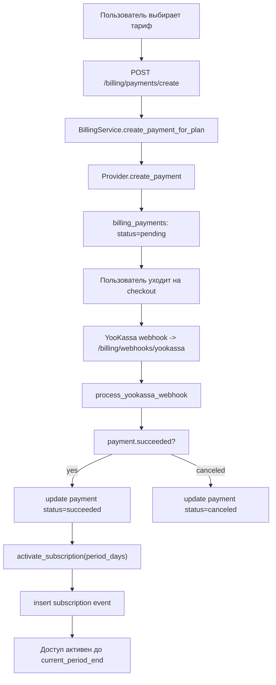

# BotTG Billing MVP

> [!summary]
> В BotTG добавлен минимально инвазивный billing-модуль под РФ-аудиторию: реальный provider сейчас `YooKassa`, вспомогательный `ManualProvider` для админских выдач уже работает, а `CloudPayments`, `Robokassa` и `Telegram Stars` оформлены как stubs для следующего этапа.

## Что сделано

- Добавлен HTTP-модуль billing в `FastAPI`.
- Добавлен сервисный слой billing в текущую архитектуру `routes -> services -> asyncpg/PostgreSQL`.
- Добавлена SQL-миграция под планы, платежи, подписки, вебхуки, usage counters и ручные override.
- Поднят реальный провайдер `YooKassaProvider` для создания платежа и обработки webhook.
- Поднят `ManualProvider` для админской выдачи доступа без внешнего эквайринга.
- Заложены stub-классы для `CloudPayments`, `Robokassa`, `Telegram Stars`.
- Добавлены admin API для ручной выдачи доступа, бана, сброса лимитов и отмены подписки.

## Где живет billing module

### FastAPI routes

- `api/routes/billing.py`

Основные endpoints:

- `GET /billing/plans`
- `POST /billing/payments/create`
- `GET /billing/payments/{payment_id}/status`
- `POST /billing/webhooks/yookassa`
- `POST /billing/promocode/apply`
- `GET /billing/me/subscription`
- `GET /billing/me/limits`
- `POST /billing/guard`
- `POST /admin/billing/users/{user_id}/grant-access`
- `POST /admin/billing/users/{user_id}/ban`
- `POST /admin/billing/users/{user_id}/reset-limits`
- `POST /admin/billing/subscriptions/{subscription_id}/cancel`

### Services / repository / providers

- `services/billing/service.py` - orchestration billing-логики
- `services/billing/repository.py` - доступ к PostgreSQL через `asyncpg`
- `services/billing/models.py` - request/response models
- `services/billing/guards.py` - интеграция guard-проверок
- `services/billing/providers/base.py` - базовый контракт provider abstraction
- `services/billing/providers/yookassa.py` - текущий реальный provider
- `services/billing/providers/manual.py` - ручной provider для админа
- `services/billing/providers/cloudpayments.py` - stub
- `services/billing/providers/robokassa.py` - stub
- `services/billing/providers/telegram_stars.py` - stub

### Database / migrations

- `migrations/2026_06_28_01_billing.sql`

Ключевые таблицы:

- `billing_plans`
- `billing_customers`
- `billing_subscriptions`
- `billing_payments`
- `billing_invoices`
- `billing_webhook_events`
- `billing_subscription_events`
- `billing_promocodes`
- `billing_promocode_uses`
- `billing_manual_overrides`
- `billing_usage_counters`

## Архитектурная позиция

> [!info]
> Billing встраивается в уже принятую архитектуру проекта: `FastAPI routes -> services -> asyncpg/PostgreSQL migrations`. `n8n` здесь не источник бизнес-логики и не место для хранения платежевого состояния; он остается оркестратором workflow, а фактические правила доступа, лимиты, подписки и webhook-обработка живут в Python/FastAPI.

Почему так:

- платежи и подписки требуют идемпотентности, статусов и предсказуемого state transition;
- это удобнее держать рядом с остальным backend-кодом, а не размазывать по n8n;
- текущий проект уже использует `asyncpg` и SQL-миграции, поэтому billing логично продолжает тот же путь.

## Sources / References

### Локальные инженерные референсы

- текущая архитектура BotTG на `FastAPI + asyncpg + SQL migrations`;
- существующие API-модули проекта как образец для envelopes, service-layer и route wiring;
- FastAPI boilerplate-подход как референс по разбиению на `routes / services / repository / models`, но без переноса в проект лишней ORM-обвязки.

### Внешние референсы

- YooKassa official docs:
  - [YooKassa Developers](https://yookassa.ru/developers/)
  - [Payment acceptance quick start](https://yookassa.ru/developers/payment-acceptance/getting-started/quick-start)
- YooKassa Python SDK:
  - [yookassa-sdk-python](https://github.com/yoomoney/yookassa-sdk-python)
- CloudPayments docs:
  - [CloudPayments Developers](https://developers.cloudpayments.ru/)
- Robokassa docs:
  - [Robokassa Docs](https://docs.robokassa.ru/)
- Telegram payments / Stars:
  - [Telegram Payments](https://core.telegram.org/bots/payments)
  - [Telegram Bot API](https://core.telegram.org/bots/api)

## Почему Stripe не основной provider

Для BotTG сейчас важнее быстрый и реалистичный платежный путь для РФ-аудитории, чем абстрактно "самый известный" глобальный провайдер.

Почему основной provider сейчас не `Stripe`:

- продукт ориентирован на российскую аудиторию и платежи в `RUB`;
- нужен локально понятный checkout и операционно привычный эквайринг;
- нужны провайдеры, которые органично встраиваются в российский контур оплат, чеков и саппорта;
- для MVP важнее быстро запустить рабочий поток оплаты, чем строить международную платежную матрицу заранее.

Поэтому:

- `YooKassa` взята как первый реальный provider;
- `CloudPayments` и `Robokassa` оставлены как логичные следующие провайдеры для РФ-рынка;
- `Stripe` можно возвращать в обсуждение позже, если у продукта появится отдельный не-РФ контур продаж.

## Почему не внедряем SQLAlchemy / Alembic / SQLAdmin сейчас

> [!warning]
> Сейчас это было бы архитектурно лишним и организационно дорогим апгрейдом ради billing MVP.

Причины:

- проект уже живет на `asyncpg`;
- схема меняется через SQL migration files;
- billing уже встроен в этот контракт без слома остального приложения;
- добавление `SQLAlchemy`, `Alembic`, `SQLAdmin` сейчас тянет за собой второй data-access stack;
- это увеличит blast radius и создаст смешанную архитектуру в момент, когда задача была сделать billing минимально инвазивно.

Принятое решение:

- оставить `asyncpg + SQL migrations` как source of truth;
- admin-функции дать через небольшой `admin API`, а не через новый ORM/admin framework;
- к полноценной админке вернуться позже, когда станет понятен реальный operational workflow.

## Тарифы

Ниже зафиксированы планы, сидированные в `migrations/2026_06_28_01_billing.sql`.

| План | Цена | Период | Посты | Источники | Каналы | Переписывания | Source checks | Candidate runs | Примечание |
|---|---:|---:|---:|---:|---:|---:|---:|---:|---|
| `beta` | 499 RUB | 30 дней | 90 | 20 | 1 | 2 | 30 | 50 | ранний доступ |
| `base` | 990 RUB | 30 дней | 150 | 30 | 1 | 3 | 60 | 100 | основной B2C |
| `pro` | 2990 RUB | 30 дней | 420 | 50 | 2 | 4 | 150 | 250 | активные владельцы каналов |
| `studio` | 7990 RUB | 30 дней | 1500 | 100 | 5 | 5 | 500 | 1000 | агентства / multi-channel ops |

### Что означают лимиты в текущем MVP

- `post_limit` - лимит публикаций
- `source_limit` - лимит подключаемых источников
- `channel_limit` - лимит каналов
- `rewrite_limit` - лимит переписываний
- `source_check_limit` - лимит source validation / source checks
- `candidate_limit` - лимит fetch / score / generate операций
- `llm_limit` - заложен в схему, но в текущем коде пока не используется как полноценный hard limit

> [!note]
> В текущем сервисе прямо проверяются действия `publish`, `source_check`, `fetch`, `score`, `generate`, `rewrite`. Поля `source_limit`, `channel_limit` и часть LLM-учета уже есть в схеме планов, но не все из них еще доведены до полного runtime enforcement на всех пользовательских сценариях.

## Provider abstraction

Базовый контракт задается через `BillingProvider` в `services/billing/providers/base.py`.

Ожидаемые методы provider:

- `create_payment(...)`
- `handle_webhook(...)`
- `get_payment_status(...)`
- `create_subscription(...)`
- `cancel_subscription(...)`
- `refund_payment(...)`
- `create_receipt(...)`
- `sync_subscription(...)`

Текущее состояние providers:

- `YooKassaProvider` - реализован `create_payment`, `handle_webhook`, `get_payment_status`
- `ManualProvider` - реализован для мгновенной ручной выдачи
- `CloudPaymentsProvider` - TODO/stub
- `RobokassaProvider` - TODO/stub
- `TelegramStarsProvider` - TODO/stub

> [!note]
> На текущем шаге `BillingService` реально регистрирует только `manual` и `yookassa`. Stub-провайдеры уже лежат в кодовой базе как подготовленные точки расширения, но еще не подключены в runtime providers map.

Это дает нормальную точку расширения: бизнес-логика подписок и лимитов остается в сервисе, а provider отвечает только за внешний платежный контур.

## Env variables

### Уже используемые текущим кодом

```bash
BILLING_ENABLED=true
BILLING_DEFAULT_PROVIDER=yookassa

YOOKASSA_SHOP_ID=your_yookassa_shop_id
YOOKASSA_SECRET_KEY=your_yookassa_secret_key
YOOKASSA_RETURN_URL=https://your-domain.tld/billing/return
```

Что писать:

- `BILLING_ENABLED` - `true` или `false`; в dev можно временно выключить billing-guard
- `BILLING_DEFAULT_PROVIDER` - сейчас обычно `yookassa`
- `YOOKASSA_SHOP_ID` - shop id из кабинета YooKassa
- `YOOKASSA_SECRET_KEY` - secret key из кабинета YooKassa
- `YOOKASSA_RETURN_URL` - URL, куда пользователь вернется после оплаты

### Рекомендуемые, но пока не читаемые кодом как обязательные

Для следующего этапа можно зарезервировать такие переменные:

```bash
CLOUDPAYMENTS_PUBLIC_ID=
CLOUDPAYMENTS_API_SECRET=

ROBOKASSA_MERCHANT_LOGIN=
ROBOKASSA_PASSWORD_1=
ROBOKASSA_PASSWORD_2=

TELEGRAM_STARS_PROVIDER_TOKEN=
```

> [!warning]
> На момент этого MVP код реально использует только `BILLING_*` и `YOOKASSA_*`. Остальные значения пока документированы как следующий шаг, а не как уже подключенный runtime-контракт.

## Webhook URL

Webhook для YooKassa:

```text
/billing/webhooks/yookassa
```

Полный production URL обычно будет вида:

```text
https://your-domain.tld/billing/webhooks/yookassa
```

## Subscription lifecycle



### По шагам

1. Клиент вызывает `POST /billing/payments/create` с `user_id`, `plan_code`, optional `provider`, `return_url`, `idempotency_key`.
2. Сервис:
   - проверяет тариф;
   - upsert-ит `billing_customers`;
   - выбирает provider;
   - создает payment у provider;
   - пишет `billing_payments` со статусом `pending` или тем, что вернул provider.
3. Пользователь проходит checkout у YooKassa.
4. YooKassa шлет webhook на `POST /billing/webhooks/yookassa`.
5. Сервис парсит webhook, сохраняет событие в `billing_webhook_events`.
6. При `payment.succeeded`:
   - платеж обновляется в `billing_payments`;
   - активируется запись в `billing_subscriptions`;
   - создается `billing_subscription_events`.
7. Доступ считается активным, пока есть подписка со статусом `active` или `trialing` и `current_period_end > NOW()`.
8. При бане доступ режется отдельно через `billing_customers.is_banned`.
9. При отмене подписка переводится в `canceled`.

## Webhook idempotency

Идемпотентность сделана в двух местах.

### 1. Идемпотентность создания платежа

В `billing_payments` есть уникальный индекс:

- `(provider, idempotency_key)`

Это защищает от повторного создания одной и той же платежной попытки со стороны клиента или retry-логики.

### 2. Идемпотентность webhook

В `billing_webhook_events` есть уникальность:

- `(provider, event_id)`

Алгоритм:

1. webhook приходит в сервис;
2. событие пытается вставиться в `billing_webhook_events`;
3. если запись уже есть, событие помечается как `duplicate`;
4. повторная бизнес-обработка не выполняется;
5. если при первом прогоне падает ошибка, статус события меняется на `failed`.

Дополнительная защита:

- перед активацией подписки сверяется сумма платежа;
- при `amount mismatch` платеж помечается как `amount_mismatch`, подписка не выдается.

## Как работают лимиты

Счетчики живут в:

- `billing_usage_counters`

Период текущего MVP:

- `day`

Хранимые счетчики:

- `posts_published`
- `source_checks`
- `fetch_runs`
- `scoring_runs`
- `generation_runs`
- `rewrites`
- `llm_tokens`

Проверка идет через:

- `POST /billing/guard`
- `BillingService.check_limit(...)`

Поддержанные actions:

- `publish`
- `source_check`
- `fetch`
- `score`
- `generate`
- `rewrite`

Правило:

- если лимит `0`, он трактуется как "без лимита";
- иначе `used + amount <= limit`.

Учет факта использования идет через:

- `BillingService.record_usage(...)`
- `BillingRepository.increment_usage(...)`

> [!note]
> В этом MVP лимиты уже заведены как отдельный доменный слой, но их полнота зависит от того, все ли пользовательские сценарии действительно вызывают guard и record_usage в нужных местах runtime.

## Админские действия

### 1. Ручная выдача доступа

Endpoint:

- `POST /admin/billing/users/{user_id}/grant-access`

Что делает:

- ищет план по `plan_code`;
- создает/обновляет customer;
- активирует подписку через `provider=manual`;
- пишет запись в `billing_manual_overrides`;
- пишет событие в `billing_subscription_events`.

Типовой use case:

- комп доступ;
- ручная выдача beta;
- продление по договоренности;
- саппорт-коррекция.

### 2. Бан пользователя

Endpoint:

- `POST /admin/billing/users/{user_id}/ban`

Что делает:

- ставит `billing_customers.is_banned = true`;
- сохраняет `ban_reason`;
- пишет manual override с action `ban`.

Эффект:

- даже при наличии активной подписки `check_user_access(...)` вернет отказ.

### 3. Сброс лимитов

Endpoint:

- `POST /admin/billing/users/{user_id}/reset-limits`

Что делает:

- обнуляет usage counters пользователя;
- логирует override с action `reset_limits`.

### 4. Отмена подписки

Endpoint:

- `POST /admin/billing/subscriptions/{subscription_id}/cancel`

Что делает:

- переводит подписку в `canceled`;
- фиксирует событие `subscription_canceled`.

## Dev / Prod запуск

### Dev

1. Заполнить общие env проекта для БД и FastAPI.
2. Добавить billing env:

```bash
BILLING_ENABLED=true
BILLING_DEFAULT_PROVIDER=yookassa
YOOKASSA_SHOP_ID=...
YOOKASSA_SECRET_KEY=...
YOOKASSA_RETURN_URL=http://localhost:8000/billing/return
```

3. Установить зависимости проекта:

```bash
pip install -r requirements.txt
```

4. Для реальных YooKassa payment calls убедиться, что установлен Python SDK `yookassa`.
5. Поднять API:

```bash
uvicorn api.main:app --reload --host 0.0.0.0 --port 8000
```

### Prod

1. Применить SQL migration до выката billing API.
2. Убедиться, что `YOOKASSA_*` заданы production-значениями.
3. Настроить публичный HTTPS URL для webhook.
4. Зарегистрировать webhook в кабинете YooKassa на:

```text
https://your-domain.tld/billing/webhooks/yookassa
```

5. Включить логирование и наблюдаемость по:
   - `billing_payments`
   - `billing_webhook_events`
   - `billing_subscription_events`
   - `billing_manual_overrides`

## Тестирование billing

### Минимальный smoke flow

1. Проверить `GET /billing/plans`.
2. Создать платеж через `POST /billing/payments/create`.
3. Убедиться, что в ответе есть `confirmation_url` для YooKassa.
4. Сымитировать webhook `payment.succeeded`.
5. Проверить:
   - `billing_payments.status = succeeded`
   - появилась запись в `billing_subscriptions`
   - `GET /billing/me/subscription` отдает активный доступ
6. Вызвать `POST /billing/guard` для нескольких действий и убедиться, что лимиты отдаются корректно.

### Unit / integration ориентиры

В репозитории уже есть billing-тесты:

- `tests/test_billing_service.py`
- `tests/test_billing_webhooks.py`
- `tests/test_billing_limits.py`

Полезные команды:

```bash
pytest tests/test_billing_service.py -v
pytest tests/test_billing_webhooks.py -v
pytest tests/test_billing_limits.py -v
pytest -k billing -v
```

## TODO

- Подключить `CloudPaymentsProvider`:
  - payment link / charge flow
  - recurrent payments
  - webhook signature verification
  - retry / failed payment handling
- Подключить `RobokassaProvider`:
  - Result URL / Success URL / Fail URL
  - signature verification
  - recurring сценарий при необходимости
  - фискализация / receipts
- Подключить `TelegramStarsProvider`:
  - `sendInvoice` / `createInvoiceLink`
  - `XTR` currency
  - продуктовая модель 7/30-day access packages или подписка
  - reconcile с `telegram_payment_charge_id`
- Довести production fiscal/legal checklist:
  - оферта
  - политика возвратов
  - обработка персональных данных
  - 54-ФЗ / чеки / ОФД контур
  - VAT / tax setup
  - support / dispute handling
  - retention policy для billing payloads
- Довести runtime enforcement до всех лимитов:
  - source count
  - channel count
  - LLM/token policy
  - продление и renewal logic
  - grace period / failed renewal / dunning

## Риски и ограничения MVP

> [!danger]
> Это рабочий billing MVP, а не финальная платежная платформа.

Главные ограничения:

- сейчас реально продакшен-готов только контур `YooKassa + manual`;
- `CloudPayments`, `Robokassa`, `Telegram Stars` пока stubs;
- код использует SQL migration и `asyncpg`, но без полноформатной admin UI;
- recurring subscriptions как полноценный lifecycle еще не доведены до renewal/dunning-сценариев;
- часть лимитов уже описана в схеме, но еще не вся доведена до полного enforcement во всех runtime потоках;
- receipt/fiscal flow пока не оформлен как production-complete контур;
- webhook parsing сделан практично для MVP, но без полного набора provider-specific security checks для всех будущих провайдеров;
- требуется аккуратная операционная дисциплина: миграции, webhook registration, observability, ручные override.

## Итог

BotTG получил billing-слой, совместимый с текущей backend-архитектурой и не тянущий за собой тяжелую смену стека. Для первого реального платежного запуска под РФ-аудиторию логика сейчас правильно собрана вокруг `YooKassa`, а остальные провайдеры уже заложены как расширяемый следующий шаг через единый `BillingProvider` контракт.
