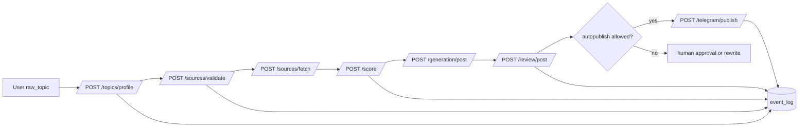

# BotTG n8n Workflows

BotTG uses n8n as an orchestrator only. Core business rules stay in Python/FastAPI.

## Workflow Set

- `WF01` Topic/profile setup
- `WF02` Source validation
- `WF04` Scheduled collection
- `WF05` Scoring
- `WF06` Generation
- `WF07` Review
- `WF08` Publishing
- `WF10` Error handling

## Control Flow

## Required Env Vars

- `DB_HOST`
- `DB_PORT`
- `DB_NAME`
- `DB_USER`
- `DB_PASSWORD`
- `TELEGRAM_BOT_TOKEN`
- `TELEGRAM_CHAT_ID`
- `OPENAI_API_KEY` or provider-specific LLM key

## Import Rule

Keep n8n nodes thin:

- HTTP Request to Python/FastAPI endpoints
- IF node for simple gating
- Set node for pass-through mapping
- No scoring, parsing, or policy logic inside n8n
