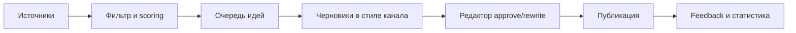

# BotTG - экономика, актуальность и прожарка идеи

> [!summary] Краткий вывод
> BotTG - сильный технический MVP автономной AI-content платформы для Telegram: сбор источников, фильтрация, LLM-скоринг, генерация постов, ревью, публикация, feedback и admin bot. Как бизнес на 2026-06-26 его лучше продавать не как "полный автопостинг без человека", а как [[Editorial Copilot]] / [[AI Trend Radar]] для Telegram-редакторов, агентств и нишевых экспертов. Экономика сходится в B2B примерно после 25-35 клиентов при цене около 19 900 ₽/мес, но только если общие источники и LLM-скоринг шарятся между клиентами, а публикация сначала идет через human-in-the-loop.

## Что уже есть в проекте

Контекст восстановлен из handoff другого агента: `C:\Users\dima\AppData\Local\Temp\handoff_BotTG_20260626_155635.md`.

BotTG сейчас делает следующее:

- собирает AI-контент из 11 источников: Habr, ProductHunt, GitHub Trending, HackerNews, FlowGPT, Reddit и др.;
- отбрасывает мусор через CPU prefilter;
- скорит идеи через LLM и психологический scoring;
- хранит идеи, посты, стиль и feedback в PostgreSQL;
- генерирует Telegram-посты в стиле канала;
- использует triple review: редактор, читатель, админ;
- публикует в Telegram-канал по расписанию;
- имеет отдельный admin bot и scoring service.

Монетизируемые функции уже сейчас:

- подбор инфоповодов;
- ранжирование идей по вероятности вовлечения;
- генерация черновиков под стиль канала;
- автопубликация;
- feedback-кнопки;
- topic/prompt management;
- scoring engine как отдельный API.

> [!warning] Текущий статус
> Это не production SaaS. По handoff тестовая среда не была полностью восстановлена, `pytest` не был надежно прогнан, а runtime все еще сильно завязан на hardcoded AI-источники.

## Актуальность на 2026-06-26

### Почему идея актуальна

1. Telegram уже достиг масштаба большой медиа-платформы. В марте 2025 сообщалось о 1 млрд monthly active users и прибыли Telegram за 2024 год.
2. Creator economy продолжает расти. Goldman Sachs-оценки, цитируемые в деловой прессе, дают ориентир около $480 млрд к 2027 году.
3. У создателей контента и агентств растет боль: нужно больше форматов, быстрее ресерчить инфоповоды, поддерживать стиль, не выгорать.
4. AI-инструменты стали нормой в content operations, но многие команды до сих пор собирают workflow из ChatGPT, RSS, Make/Zapier, Buffer и ручной редакторской работы.

### Почему идея рискованна именно сейчас

1. Telegram-зависимость опасна. В России с августа 2025 начались ограничения звонков Telegram/WhatsApp, а в феврале 2026 появились сообщения об ограничениях Telegram. Даже если продукт продается не только в РФ, platform risk нужно считать.
2. AI-cost risk реален: в 2026 аналитики обсуждают резкий рост enterprise token consumption и пока ограниченные доказательства измеримого ROI у компаний.
3. AI-generated content стал commodity. Если продукт просто переписывает новости, он быстро тонет в одинаковом шуме.
4. Автопубликация без человека может вредить бренду клиента.

## Где и как использовать

### 1. AI Trend Radar

Лучший первый продукт.

Пользователь получает каждый день:

- 20-50 найденных инфоповодов;
- источник и краткое объяснение "почему важно";
- score;
- 3 угла подачи;
- черновик Telegram-поста;
- кнопку approve/rewrite/reject.

Кому продавать:

- владельцам Telegram-каналов;
- B2B SaaS-командам;
- экспертам;
- редакторам нишевых медиа.

Почему это лучше автопостинга: ниже репутационный риск и проще доказать ценность через экономию времени редактора.

### 2. Editorial Copilot для Telegram

Продукт помогает редактору, но не заменяет его полностью.

Поток:

Ключевая метрика: сэкономленные часы редактора и доля опубликованных черновиков.

### 3. Content Ops для агентств

Агентство ведет 10-50 Telegram-каналов клиентов. BotTG становится внутренним движком:

- общие источники;
- отдельные темы/стили;
- approval flow;
- лимиты по клиентам;
- отчеты по постам и реакциям.

Это самый денежный B2B-сценарий, но он требует multi-tenant архитектуры.

### 4. White-label для узкой ниши

Например:

- AI-инструменты для HR;
- legal tech;
- продажи и маркетинг;
- developer tools;
- кибербезопасность.

Узкая ниша лучше, чем "AI обо всем": проще источники, понятнее аудитория, выше willingness to pay.

### 5. Scoring API

Отдельный продуктовый модуль:

- оценка постов по полезности, сохранениям, репостабельности, практичности;
- рекомендации по улучшению;
- batch scoring контента редакции.

Это может продаваться как add-on к основному продукту.

## Экономика

### Тарифная сетка

| Сегмент | Тариф | Цена | Что входит |
|---|---:|---:|---|
| B2C | Starter | 990-1 490 ₽/мес | 1 канал, 1 тема, 1-2 поста/день, базовый стиль |
| B2C | Creator | 2 990-4 990 ₽/мес | 1-2 канала, 3-5 постов/день, обучение стилю, preview |
| B2C | Pro Creator | 7 990-9 990 ₽/мес | до 3 каналов, свои источники, расширенный scoring |
| B2B | Business | 14 900-19 900 ₽/мес | 1 канал, до 10 источников, admin bot, scoring |
| B2B | Business Plus | 29 900-49 900 ₽/мес | 3-5 каналов, кастомные темы, approval workflow |
| B2B | Agency | 79 900-149 900 ₽/мес | 10-30 каналов, роли, лимиты, отчеты |
| White-label | Setup | 150 000-500 000 ₽ разово | кастомизация, окружение, брендирование |
| White-label | Support | 49 900-199 000 ₽/мес | поддержка, парсеры, SLA |

### Cost drivers

Главные расходы:

- LLM: scoring, generation, review, rewrite, deep research, style extraction;
- hosting: bot, admin bot, scoring service, PostgreSQL;
- прокси/парсинг: Reddit, ProductHunt, GitHub, HTML/RSS, rate limits;
- поддержка: onboarding, промпты, источники, разбор ошибок;
- observability: логи, алерты, retries, мониторинг LLM-расходов;
- кастомизация под ниши.

### Базовая unit economics модель

Допущение: тариф `Business` за 19 900 ₽/мес, 1 клиент = 1 канал, 4 поста/день, около 120 постов/мес.

| Статья | ₽/клиент/мес |
|---|---:|
| LLM | 5 500 |
| Hosting/DB/backup | 1 200 |
| Прокси/парсинг | 1 000 |
| Поддержка и onboarding | 2 500 |
| Резерв на ошибки | 800 |
| **Итого переменные расходы** | **11 000** |
| **Валовая прибыль** | **8 900** |
| **Валовая маржа** | **45%** |

### Сценарии

| Клиентов | MRR | Переменные расходы | Валовая прибыль | Фикс. расходы | Опер. результат |
|---:|---:|---:|---:|---:|---:|
| 10 | 199 000 ₽ | 110 000 ₽ | 89 000 ₽ | 180 000 ₽ | -91 000 ₽ |
| 50 | 995 000 ₽ | 550 000 ₽ | 445 000 ₽ | 250 000 ₽ | +195 000 ₽ |
| 200 | 3 980 000 ₽ | 2 200 000 ₽ | 1 780 000 ₽ | 550 000 ₽ | +1 230 000 ₽ |

Break-even:

$$
\text{clients} = \frac{250000}{8900} \approx 29
$$

> [!tip] Что делает экономику рабочей
> Общие источники должны парситься один раз и шариться между клиентами. LLM scoring должен идти после жесткого CPU-prefilter. Клиентские лимиты на посты, источники и deep research обязательны.

## Grill-me: жесткая прожарка

### 10 вопросов, на которые надо ответить до продажи

1. Кто конкретно платит: владелец канала, агентство, медиа, B2B SaaS или инфобизнес?
2. За что платят: автопостинг, экономия редактора, рост канала, поиск трендов или white-label инфраструктура?
3. Какая метрика доказывает ценность: ER, saves, reposts, CTR, прирост подписчиков, часы редактора?
4. Почему клиент не соберет 70% этого через ChatGPT + RSS + Make/Zapier?
5. Где moat: данные, workflow, метрики, стиль, интеграции, дистрибуция?
6. Можно ли доверять `triple_review`, если при ошибках он иногда пропускает пост?
7. Что будет, если 3-5 источников изменят HTML или заблокируют парсинг?
8. Почему B2B-клиент должен ставить `.env`, PostgreSQL, Docker и Telegram bots?
9. Как решается legal/story по перепаковке чужого контента?
10. Какой платный кейс можно показать за 7 дней?

### Что может убить проект

- Нет доказанного ICP.
- Нет связи scoring с ростом канала или деньгами клиента.
- Парсеры слишком хрупкие.
- Автономная публикация портит бренд.
- Topic system не стала ядром runtime.
- Нет SaaS onboarding.
- Нет multi-tenant, billing, roles, quotas.
- LLM-расходы съедают маржу.
- Контент становится commodity.
- Тестовая и продовая зрелость не доказаны.

## Рекомендованное позиционирование

Не продавать как:

> "Автономный бот, который сам ведет ваш канал".

Продавать как:

> "AI Trend Radar и редакторский copilot для Telegram: находит инфоповоды, объясняет ценность, пишет черновики в стиле канала и дает редактору контроль перед публикацией".

Почему так:

- меньше страха у B2B-клиента;
- проще доказать ROI;
- меньше legal/reputation risk;
- текущий код уже близок к этому сценарию;
- можно продавать до полноценного SaaS.

## План на 30 дней

### Неделя 1: доказать спрос

- поговорить с 10 владельцами каналов/агентствами;
- показать 3 оффера: Trend Radar, Editorial Copilot, Autopublishing;
- получить 2-3 LOI или предоплаты;
- зафиксировать главную метрику ценности.

### Неделя 2: сделать демо без DevOps

- один демо-канал;
- один approval flow;
- отчет "до/после": время редактора, качество черновиков, доля принятых идей;
- ручной onboarding вместо SaaS.

### Неделя 3: закрыть технические блокеры

- восстановить `.venv`;
- прогнать `pytest`;
- исправить критические тесты;
- добавить лимиты LLM;
- сделать parser-monitoring.

### Неделя 4: первый платный пилот

- 1-3 клиента;
- тариф 14 900-19 900 ₽/мес;
- human-in-the-loop;
- ежедневный отчет по идеям/черновикам;
- критерий успеха: клиент публикует 30%+ предложенных черновиков и готов продлить.

## Go / No-Go

Go, если за 30 дней:

- 2+ клиента готовы платить;
- редактор принимает 30%+ черновиков;
- LLM-cost на клиента укладывается в 25-30% цены;
- setup клиента занимает меньше 2 часов;
- источники дают стабильный поток идей.

No-Go или pivot, если:

- все хотят "посмотреть", но никто не платит;
- клиенты не доверяют автогенерации даже с approval;
- большая часть ценности оказывается в ручной редактуре;
- Telegram-риск делает канал неподходящей основной платформой;
- LLM-cost превышает маржу.

## Источники

### Локальные

- `README.md`
- `PSYCHOLOGICAL_SCORING_SYSTEM.md`
- `main.py`
- `llm_generator.py`
- `scoring/engine.py`
- `C:\Users\dima\AppData\Local\Temp\handoff_BotTG_20260626_155635.md`

### Внешние

- [Business Insider: Telegram reached 1B monthly active users and reported 2024 profit](https://www.businessinsider.com/telegram-celebrates-1-billion-active-users-pavel-durov-swipe-whatsapp-2025-3)
- [New York Post: creator economy estimated around $250B and expected near $480B by 2027](https://nypost.com/2026/06/10/business/creators-launching-companies-building-software-and-investing/)
- [Business Insider: Goldman Sachs on AI capex, token consumption, and limited quantified ROI](https://www.businessinsider.com/stock-market-wall-street-tech-selloff-ai-token-goldman-sachs-2026-6)
- [The Guardian / Reuters: Russia restricted Telegram and WhatsApp calls in August 2025](https://www.theguardian.com/world/2025/aug/13/russia-clamps-down-on-whatsapp-and-telegram-over-data-sharing)

## Итог

BotTG актуален, но не как "магический автоканал". Самый реалистичный путь - продать узкий painkiller: ежедневный AI Trend Radar + черновики в стиле канала + контроль редактора. После 2-3 платных пилотов можно решать, строить ли SaaS, agency workflow или white-label.
