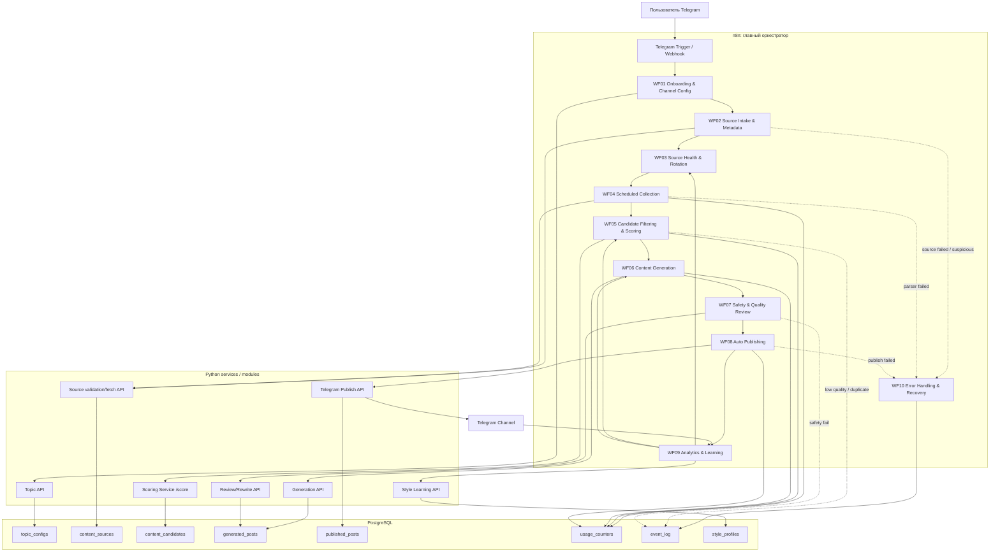
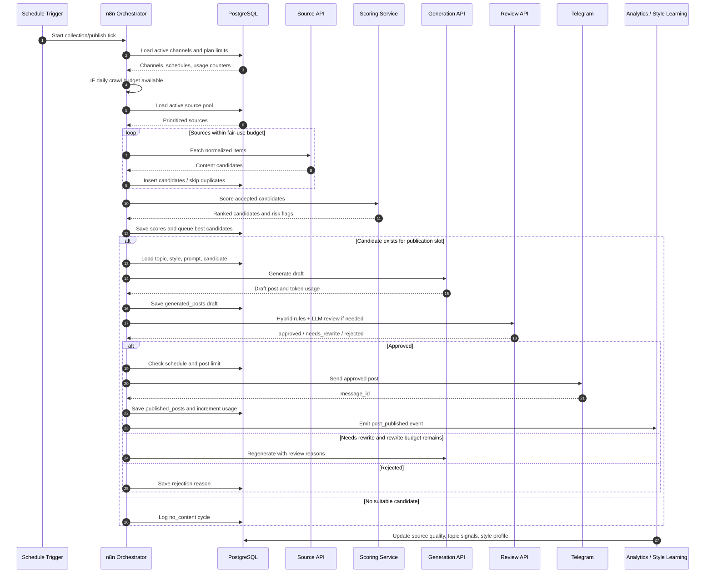

# BotTG - n8n Architecture and Workflows

> [!summary]
> Этот документ фиксирует архитектуру BotTG как универсального content factory для Telegram, где n8n является главным оркестратором, а Python-модули подключаются к нему как отдельные сервисы через HTTP, Webhook, Execute Command или PostgreSQL.

## Суть Решения

BotTG не должен быть одним большим Python-ботом с внутренним scheduler. Целевая архитектура: n8n управляет состоянием, расписанием, ветвлениями, retry, лимитами тарифов и очередями, а Python выполняет тяжелую предметную работу: парсинг, скоринг, генерацию, проверки, публикацию и обучение стилю.

Главная формула продукта:

```text
Тема -> Источники -> Фильтрация -> Scoring -> Генерация -> Проверка -> Автопубликация -> Аналитика -> Дообучение стиля
```

Принятые продуктовые ограничения:

- проект универсальный, не привязан к одной нише;
- пользователь задает тему канала свободным текстом;
- источники и стиль настраиваются после темы;
- пользователь может добавить источник только по URL;
- система сама определяет метаданные источника;
- публикация после настройки автоматическая, без подтверждения каждого поста;
- стиль дообучается постоянно;
- проверки закона, порно и качества гибридные: правила первыми, LLM только где нужно;
- токены нужно экономить на каждом этапе;
- подозрительные источники требуют предупреждения и подтверждения пользователя;
- источники выглядят неограниченными для пользователя, но исполнение ограничено fair-use.

## Почему n8n Как Оркестратор

n8n хорошо подходит как визуальный слой управления: в нем удобно видеть цепочки, условия, retry, запуск по расписанию и разбиение на sub-workflows. По официальной документации n8n можно вызывать один workflow из другого, что подходит для модульной архитектуры и не превращает главный workflow в огромную схему. Также n8n поддерживает Error Trigger workflows для централизованной обработки ошибок.

Практическая граница такая:

| Слой | Чем занимается | Где живет |
|---|---|---|
| Оркестрация | Расписание, очереди, IF/Switch, retry, лимиты, статусы | n8n |
| Предметная логика | Парсинг, скоринг, генерация, review, публикация | Python/FastAPI |
| Данные | Источники, кандидаты, посты, тарифы, события | PostgreSQL |
| Интеграции | Telegram, webhook, уведомления, админские формы | n8n + Telegram nodes |

## Текущая База Проекта

В проекте уже есть рабочие блоки, которые можно переиспользовать:

| Файл | Что есть сейчас | Как использовать в n8n-архитектуре |
|---|---|---|
| `main.py` | scheduler, сбор, публикация, команды Telegram, style feedback | источник бизнес-правил; постепенно вынести функции из монолита |
| `parsers.py` | RSS/HTML парсеры и фабрики динамических парсеров | обернуть в `POST /sources/fetch` |
| `scoring_service.py` | FastAPI `/health` и `/score` | оставить первым готовым HTTP-модулем |
| `llm_generator.py` | генерация, deep research, review, rewrite, style extraction | обернуть в generation/review/style API |
| `database.py` | PostgreSQL слой для идей, постов, стиля, feedback | расширить таблицами n8n-пайплайна |
| `topic_config.py` | CRUD тем, источников и topic config | использовать для onboarding и channel config |
| `topic_prompt_manager.py` | prompt generation/cache | подключить позже как prompt-management module |

> [!warning]
> `main.py` сейчас содержит слишком много ролей: bot runtime, scheduler, выбор идей, публикацию, тренды и команды. Для n8n его нельзя считать модульной границей. Его нужно использовать как источник правил, но не как главный API.

## Модули MVP

### 1. Topic Intake / Channel Config

Ответственность: принять тему свободным текстом, нормализовать ее, создать конфиг канала и сохранить базовые настройки.

Вход:

```json
{
  "user_id": 123,
  "telegram_channel_id": "@channel",
  "raw_topic": "новости про мобильные приложения и стартапы",
  "timezone": "Asia/Yekaterinburg"
}
```

Выход:

```json
{
  "topic_config_id": 42,
  "normalized_topic": "мобильные приложения, стартапы, софт",
  "keywords": ["мобильные приложения", "стартапы", "софт"],
  "status": "topic_configured"
}
```

Вызов из n8n: `Telegram Trigger` или `Webhook` -> `HTTP Request` к Python API -> `Postgres`.

Переиспользовать: `topic_config.create_topic`, `get_topic`, `update_topic`.

Новая обертка: `POST /topics`, `PATCH /topics/{id}`.

### 2. Source Intake / Source Validation

Ответственность: принять URL, проверить доступность, тип контента, авторитетность и соответствие теме.

Вход:

```json
{
  "workflow_run_id": "n8n-2026-06-26-001",
  "topic_config_id": 42,
  "topic_description": "мобильные приложения, стартапы, софт",
  "url": "https://example.com/feed",
  "validation_depth": "standard"
}
```

Выход:

```json
{
  "source_id": 10,
  "url": "https://example.com/feed",
  "name": "Example Feed",
  "description": "Источник новостей по приложениям и стартапам",
  "topic": "софт и приложения",
  "source_type": "news",
  "authority": 72,
  "verification_status": "verified",
  "access_mode": "rss",
  "requires_user_confirmation": false,
  "reason": "Источник доступен, обновляется и соответствует теме"
}
```

Вызов из n8n: `Execute Sub-workflow` для каждого URL, внутри `HTTP Request`, `HTML Extract`, `IF`, `Switch`, `Postgres`.

Переиспользовать: `parsers.make_rss_parser`, `make_html_parser`, `build_parsers_for_topic`.

Новая обертка: `POST /sources/validate`, `POST /sources/sample`.

### 3. Content Fetching

Ответственность: собрать материалы из активного пула источников с учетом crawl budget.

Вход:

```json
{
  "workflow_run_id": "n8n-2026-06-26-collection-001",
  "topic_config_id": 42,
  "source_ids": [10, 11, 12],
  "limit_per_source": 10,
  "since": "2026-06-25T00:00:00+05:00",
  "crawl_budget_units": 100
}
```

Выход:

```json
{
  "fetch_run_ids": [1001, 1002],
  "candidates_created": 28,
  "duplicates_skipped": 7,
  "failed_sources": [],
  "remaining_budget_units": 72
}
```

Вызов из n8n: `Schedule Trigger` -> `Postgres Select` -> `Loop Over Items` -> `Switch access_mode` -> `HTTP Request` или Python API.

Переиспользовать: текущие parser functions из `parsers.py`.

Новая обертка: `POST /sources/fetch`.

### 4. Dedup / Prefilter / Trend Detection

Ответственность: убрать дубли, мусор, слишком короткие материалы, неподходящие темы, базовые hard-block риски.

Вход: список `content_candidates`.

Выход: accepted/rejected candidates, причины отклонения, trends.

Вызов из n8n: `Execute Sub-workflow` или `HTTP Request`.

Переиспользовать: `database.is_title_duplicate`, `main.detect_trends`, `extract_keywords`, `extract_ngrams`, `scoring.prefilter.cpu_prefilter`.

Новая обертка: `POST /items/prefilter`.

### 5. Candidate Scoring

Ответственность: оценить кандидаты по релевантности, полезности, новизне, сохранению в избранное и риску.

Вызов из n8n: `HTTP Request` в уже существующий `scoring_service.py` endpoint `/score`.

Переиспользовать: `scoring_service.score_items`, `scoring.prefilter`, `scoring.llm_scorer`.

Что улучшить в контракте:

```json
{
  "topic_config_id": 42,
  "items": [],
  "save_to_db": true,
  "thresholds": {
    "min_total_score": 30,
    "generation_threshold": 70
  }
}
```

> [!warning]
> Сейчас scoring service одновременно оценивает и пишет в БД. Для n8n лучше добавить `save_to_db: true/false`, чтобы side effects были управляемыми.

### 6. Idea Selection / Publish Decision

Ответственность: выбрать лучший кандидат под ближайший publication slot.

Вход: topic, schedule, candidates, лимиты тарифа, последние публикации.

Выход:

```json
{
  "selected_candidate_id": 555,
  "decision": "generate",
  "reason": "score 86, источник надежный, слот свободен"
}
```

Вызов из n8n: простые правила можно делать в `IF/Switch`, сложную логику лучше вынести в `POST /ideas/select`.

Переиспользовать: `main.get_time_bucket`, `get_preferred_categories`, `database.get_category_stats`.

### 7. Context Builder / Deep Research

Ответственность: собрать компактный контекст для генерации и при необходимости добавить research notes.

Вход: selected candidate, source metadata, topic profile, style profile.

Выход: `context_text`, `source_refs`, `research_notes`.

Вызов из n8n: `HTTP Request`.

Переиспользовать: `llm_generator.deep_research`.

Новая обертка: `POST /context/build`.

### 8. Post Generation

Ответственность: сгенерировать Telegram-пост под тему и стиль канала.

Вход:

```json
{
  "workflow_run_id": "n8n-2026-06-26-generation-001",
  "topic_config_id": 42,
  "candidate_id": 555,
  "prompt_id": 8,
  "style_profile_id": 15,
  "format": "telegram_html",
  "max_words": 180,
  "rewrite_budget": 3
}
```

Выход:

```json
{
  "generated_post_id": 901,
  "post_text": "<b>Заголовок</b>...",
  "version": 1,
  "status": "draft",
  "tokens_input": 3500,
  "tokens_output": 1200
}
```

Вызов из n8n: `HTTP Request` в generation API.

Переиспользовать: `llm_generator.generate_post_from_context`, `topic_prompt_manager.assemble_generation_prompt`.

Новая обертка: `POST /generation/post`.

### 9. Safety / Quality / Rewrite Gate

Ответственность: гибридно проверить закон, порно, качество, стиль, длину и нейромаркеры.

Схема экономии токенов:

1. Rule check: длина, пустой текст, HTML, стоп-слова, очевидное порно, hard-block категории.
2. Cheap style check: структура, тон, длина, наличие "нейроречевых" клише.
3. LLM safety review только для серой зоны.
4. LLM quality review только для сильных кандидатов или спорных drafts.
5. Rewrite максимум по лимиту тарифа.

Вызов из n8n: `IF` hard reject -> `HTTP Request /review/post` -> `IF approved` -> publication queue.

Переиспользовать: `llm_generator.triple_review`, `compile_feedback`, `rewrite_with_feedback`.

Новая обертка: `POST /review/post`, `POST /review/rewrite`.

### 10. Telegram Publishing

Ответственность: опубликовать approved draft в канал и записать результат.

Вход:

```json
{
  "workflow_run_id": "n8n-2026-06-26-publish-001",
  "generated_post_id": 901,
  "target_channel": "@channel",
  "publish_mode": "now",
  "idempotency_key": "generated-post-901"
}
```

Выход:

```json
{
  "published_post_id": 300,
  "telegram_message_id": 777,
  "published_at": "2026-06-26T18:30:00+05:00",
  "status": "published"
}
```

Вызов из n8n: лучше через `Telegram` node для отправки сообщений или через Python `POST /telegram/publish`, если нужны кастомные inline buttons и idempotency.

Переиспользовать: `bot.send_message` логику из `main.publish_best_job`, `get_feedback_keyboard`, `database.save_post`.

Новая обертка: `POST /telegram/publish`.

> [!important]
> Публикация должна быть идемпотентной. n8n retry может случайно отправить один и тот же пост повторно, если не хранить `idempotency_key`.

### 11. Analytics / Continuous Style Learning

Ответственность: собирать реакции, метрики, обновлять качество источников и профиль стиля.

Вызов из n8n: `Schedule Trigger` раз в 6/12/24 часа + `Telegram Trigger` или webhook для feedback buttons.

Переиспользовать: `database.get_feedback_stats`, `get_liked_posts`, `get_disliked_posts`, `add_post_feedback`, `llm_generator.extract_style_profile`.

Новые обертки:

- `POST /feedback`
- `GET /analytics/summary`
- `POST /style/retrain`
- `GET /style/profile`

## Модули Later

| Модуль | Когда нужен | Что делает |
|---|---|---|
| Human Approval Queue | для агентств и high-risk тем | ручное approve/edit/reject, не часть обычного автопостинга |
| Media / Image Generation | после текстового MVP | изображения, обложки, карточки |
| Multi-channel Routing | когда появится Studio tier | разные каналы, темы, стили, расписания |
| Prompt Management UI | после стабилизации генерации | версии prompts, откат, тесты |
| Observability Dashboard | перед масштабированием | run status, cost, errors, latency |
| Dead Letter Queue | при росте нагрузки | хранение failed jobs и ручной retry |
| Agency Reporting | для Studio | отчеты по каналам и клиентам |

## n8n Workflow Map

Главное правило: не делать один workflow на 200 nodes. Нужно 10 коротких workflows с понятными контрактами.

| # | Workflow | Назначение |
|---|---|---|
| WF01 | Onboarding & Channel Config | тема -> источники -> стиль -> расписание |
| WF02 | Source Intake & Metadata | URL -> metadata -> source validation |
| WF03 | Source Health & Rotation | проверка источников и активный пул |
| WF04 | Scheduled Collection | регулярный сбор кандидатов |
| WF05 | Candidate Filtering & Scoring | дедуп, правила, cheap score, LLM score |
| WF06 | Content Generation | генерация drafts под publication slots |
| WF07 | Safety & Quality Review | гибридные проверки и rewrite |
| WF08 | Auto Publishing | публикация без подтверждения человека |
| WF09 | Analytics & Learning | feedback, источники, стиль, отчеты |
| WF10 | Error Handling & Recovery | retry, деградация, alert, event_log |

### WF01 Onboarding & Channel Config

Триггер: `Telegram Trigger` или `Webhook`.

Nodes:

1. `Telegram Trigger: User Message`
2. `Switch: Onboarding Step`
3. `Set: Normalize User Input`
4. `IF: Has Channel Connected?`
5. `HTTP Request: Validate Telegram Channel Access`
6. `Postgres: Upsert User`
7. `Postgres: Upsert Channel`
8. `LLM: Normalize Free-Text Topic`
9. `Postgres: Save Topic Profile`
10. `Loop Over Items: Source URLs`
11. `Execute Sub-workflow: WF02 Source Intake & Metadata`
12. `Set: Style Setup Payload`
13. `LLM: Extract Style Profile From Examples`
14. `Postgres: Save Style Profile`
15. `IF: Schedule Valid?`
16. `Postgres: Save Publishing Schedule`
17. `Postgres: Mark Channel Active`
18. `Telegram: Send Setup Complete`

Выход: `user_id`, `topic_config_id`, `style_profile_id`, `schedule`, `plan_limits`, `channel_status=active`.

### WF02 Source Intake & Metadata

Триггер: `Execute Sub-workflow Trigger` или `Webhook: Add Source URL`.

Nodes:

1. `Execute Sub-workflow Trigger: Source URL`
2. `Set: Normalize URL`
3. `Postgres: Check Existing Source`
4. `IF: Source Already Exists?`
5. `HTTP Request: Fetch URL Head`
6. `IF: URL Reachable?`
7. `HTTP Request: Fetch HTML/RSS`
8. `Switch: Detect Access Mode`
9. `HTML Extract: Title / Description / RSS Links`
10. `LLM: Classify Source Metadata` только если правила не уверены
11. `HTTP Request: Sample Recent Items`
12. `Execute Sub-workflow: WF05 Candidate Filtering & Scoring` в режиме `source_validation`
13. `IF: Source Quality >= Threshold?`
14. `Postgres: Save Source Metadata`
15. `Postgres: Save Source Validation Result`
16. `Telegram: Notify Source Accepted / Rejected / Weak`

Ветвления:

- existing source -> привязать к теме без повторной глубокой проверки;
- unreachable -> `verification_status=failed`;
- weak/suspicious -> `needs_user_confirmation`;
- unsupported access -> `unsupported_access`.

### WF03 Source Health & Rotation

Триггер: `Schedule Trigger`, например каждые 6 часов.

Nodes:

1. `Schedule Trigger: Source Health Check`
2. `Postgres: Get Sources Due For Check`
3. `Loop Over Items: Sources`
4. `HTTP Request: Lightweight Health Probe`
5. `IF: Source Responds?`
6. `HTTP Request: Fetch Latest Sample`
7. `Set: Calculate Freshness / Error Rate`
8. `IF: Needs LLM Reclassification?`
9. `LLM: Re-evaluate Source Quality`
10. `Postgres: Update Source Health`
11. `Postgres: Rebuild Active Source Pool`

Активный пул строится по authority, relevance, freshness, historical quality, error rate и тарифу.

### WF04 Scheduled Collection

Триггер: `Schedule Trigger` каждые 30-60 минут и отдельный запуск перед публикационными окнами.

Nodes:

1. `Schedule Trigger: Collection Tick`
2. `Postgres: Get Active Channels`
3. `Loop Over Items: Channels`
4. `Postgres: Get Channel Limits`
5. `IF: Daily Crawl Budget Available?`
6. `Postgres: Get Active Source Pool`
7. `Loop Over Items: Sources`
8. `Switch: Source Access Mode`
9. `HTTP Request: Fetch RSS/API/HTML` или `HTTP Request: /sources/fetch`
10. `Set: Normalize Raw Items`
11. `Postgres: Insert Raw Candidates`
12. `Execute Sub-workflow: WF05 Candidate Filtering & Scoring`

Fair-use:

- не обходить все источники каждый тик;
- batch size ограничен тарифом;
- wait/backoff на домен;
- слабые источники обходятся реже;
- новые источники получают короткое тестовое окно.

### WF05 Candidate Filtering & Scoring

Триггер: `Execute Sub-workflow Trigger` из WF04/WF02 или queue по `raw_candidates`.

Nodes:

1. `Execute Sub-workflow Trigger: Candidate Batch`
2. `Postgres: Load Candidate Batch`
3. `Loop Over Items: Candidates`
4. `Set: Normalize Text`
5. `Postgres: Check Duplicate By URL/Title/Hash`
6. `IF: Duplicate?`
7. `Rule Check: Language / Length / Empty / Bad Encoding`
8. `Rule Check: Porn Keywords / Illegal Hard Blocks`
9. `Rule Check: Topic Keyword Match`
10. `IF: Rule Reject?`
11. `Set: Cheap Score`
12. `IF: Needs LLM Scoring?`
13. `HTTP Request: /score`
14. `Set: Final Candidate Score`
15. `IF: Score >= Generation Threshold?`
16. `Postgres: Save Scored Candidate`
17. `Postgres: Queue For Generation`

Экономия LLM:

- очевидный мусор и дубли не доходят до LLM;
- trusted sources получают меньше LLM-проверок;
- weak sources получают LLM только при неожиданно высоком cheap score;
- LLM scoring включается для серой зоны и потенциально сильных кандидатов.

### WF06 Content Generation

Триггер: `Schedule Trigger` перед publication slot или `Execute Sub-workflow` из WF05.

Nodes:

1. `Schedule/Execute Trigger: Generation Queue`
2. `Postgres: Get Publishing Slots Needing Drafts`
3. `Postgres: Get Top Scored Candidates`
4. `IF: Candidate Available?`
5. `Postgres: Load Topic + Style Profile`
6. `Set: Build Generation Context`
7. `HTTP Request: /generation/post`
8. `Set: Normalize Generated Post`
9. `Postgres: Save Draft`
10. `Execute Sub-workflow: WF07 Safety & Quality Review`

Если кандидатов нет, слот получает событие `no_content`, а workflow не генерирует текст ради генерации.

### WF07 Safety & Quality Review

Триггер: `Execute Sub-workflow Trigger` из WF06.

Nodes:

1. `Execute Sub-workflow Trigger: Draft Review`
2. `Postgres: Load Draft + Candidate + Channel Rules`
3. `Rule Check: Hard Legal/Porn Blocks`
4. `Rule Check: Links / Mentions / Forbidden Topics`
5. `Rule Check: Length / Readability / Empty Claims`
6. `IF: Hard Reject?`
7. `IF: Needs LLM Safety Review?`
8. `HTTP Request: /review/post`
9. `IF: Needs LLM Quality Review?`
10. `HTTP Request: /review/post`
11. `IF: Review Passed?`
12. `Postgres: Mark Draft Approved`
13. `Postgres: Mark Draft Rejected`
14. `IF: Can Regenerate?`
15. `Execute Sub-workflow: WF06 Content Generation` в режиме `regeneration`
16. `Execute Sub-workflow: WF08 Auto Publishing` если время публикации близко

Важно: human approval не используется в обычной логике. Он нужен только как later-модуль для агентств или high-risk тем.

### WF08 Auto Publishing

Триггер: `Schedule Trigger` каждую минуту или 5 минут.

Nodes:

1. `Schedule Trigger: Publish Tick`
2. `Postgres: Get Due Approved Drafts`
3. `Loop Over Items: Drafts`
4. `Postgres: Check Channel Active + Subscription`
5. `IF: Publication Allowed Now?`
6. `Telegram: Send Message` или `HTTP Request: /telegram/publish`
7. `IF: Telegram Publish Success?`
8. `Postgres: Save Published Post`
9. `Postgres: Mark Candidate Published`
10. `Postgres: Increment Usage Counter`
11. `Execute Sub-workflow: WF09 Analytics & Learning` с событием `published`

Публикация блокируется, если:

- тарифный лимит постов исчерпан;
- draft не `approved`;
- канал не активен;
- расписание не наступило;
- idempotency key уже опубликован.

### WF09 Analytics & Learning

Триггер: `Schedule Trigger` каждые 6/12/24 часа + feedback webhook.

Nodes:

1. `Webhook/Telegram Trigger: Feedback Event`
2. `Postgres: Save Reaction`
3. `Schedule Trigger: Daily Analytics`
4. `Postgres: Load Published Posts Metrics`
5. `HTTP Request: Telegram Stats If Available`
6. `Set: Calculate Post Performance`
7. `Postgres: Update Source Performance`
8. `Postgres: Update Topic Signals`
9. `IF: Enough Feedback For Style Update?`
10. `HTTP Request: /style/retrain`
11. `Postgres: Save Learning Snapshot`

Сигналы возвращаются в систему:

- `source_quality_delta`;
- `topic_preference_delta`;
- `style_profile_delta`;
- `best_formats`;
- `bad_patterns`;
- `engagement_metrics`.

### WF10 Error Handling & Recovery

Триггер: n8n `Error Trigger`.

Nodes:

1. `Error Trigger: Any Workflow Failed`
2. `Set: Normalize Error Payload`
3. `Switch: Failed Workflow`
4. `Switch: Error Type`
5. `IF: Retryable?`
6. `Wait: Backoff`
7. `Execute Sub-workflow: Retry Failed Unit`
8. `Postgres: Log Workflow Error`
9. `IF: User Impacting?`
10. `Telegram/Admin Notification`
11. `Postgres: Mark Source/Draft/Channel Degraded`

Retryable:

- network timeout;
- temporary LLM/API error;
- Telegram 429/5xx;
- parser timeout;
- transient DB connection failure.

Not retryable:

- hard legal/porn block;
- unsupported source;
- duplicate;
- invalid Telegram permissions;
- exhausted subscription limit.

## Главная Визуальная Схема



## Sequence Цикла Публикации



## Данные И Таблицы

MVP строится как надстройка над текущими таблицами:

- `topic_configs` остается центром настройки темы/канала;
- `ideas_pool` остается совместимым пулом отскоренных идей;
- `published_posts` остается фактом публикации;
- `channel_style_examples`, `channel_style_profile`, `post_feedback` остаются ядром style learning;
- новые таблицы добавляют источники, workflow-контракты, лимиты, статусы и события.

### Новые MVP-сущности

| Таблица | Назначение |
|---|---|
| `content_sources` | каталог источников, их metadata, режим доступа и качество |
| `source_validation_runs` | история проверок источников |
| `source_fetch_runs` | история обходов источников |
| `content_candidates` | сырые материалы до генерации |
| `generated_posts` | drafts, версии, review и schedule |
| `subscription_plans` | тарифные лимиты |
| `usage_counters` | fair-use счетчики |
| `event_log` | журнал событий для аналитики, отладки и обучения |

### `content_sources`

| Поле | Назначение |
|---|---|
| `id` | ID источника |
| `topic_config_id` | связь с `topic_configs.id` |
| `url` | канонический URL |
| `domain` | нормализованный домен |
| `name` | название источника |
| `description` | описание для пользователя |
| `topic` | распознанная тематика |
| `source_type` | `news`, `blog`, `official`, `social`, `forum`, `docs`, `marketplace`, `other` |
| `authority` | оценка авторитетности 0-100 |
| `verification_status` | статус проверки |
| `access_mode` | `rss`, `api`, `html` |
| `rss_url` | найденный RSS |
| `language` | язык источника |
| `is_user_added` | пользовательский или системный |
| `is_active` | входит ли в активный пул |
| `priority` | приоритет обхода |
| `last_checked_at` | последняя проверка |
| `last_success_at` | последний успешный сбор |
| `last_error` | последняя ошибка |

### `content_candidates`

| Поле | Назначение |
|---|---|
| `id` | ID кандидата |
| `topic_config_id` | тема/канал |
| `source_id` | источник |
| `external_id` | ID материала во внешнем источнике |
| `url` | ссылка |
| `title` | заголовок |
| `summary` | краткое содержание |
| `raw_text` | извлеченный текст |
| `published_at_source` | дата у источника |
| `content_hash` | хэш для дедупликации |
| `relevance_score` | релевантность |
| `quality_score` | качество |
| `novelty_score` | новизна |
| `risk_score` | риск |
| `status` | lifecycle status |
| `reject_reason` | причина отклонения |

### `generated_posts`

| Поле | Назначение |
|---|---|
| `id` | ID draft/post |
| `topic_config_id` | тема/канал |
| `candidate_id` | исходный кандидат |
| `idea_id` | связь с `ideas_pool`, если нужна совместимость |
| `prompt_id` | версия prompt |
| `style_profile_id` | версия стиля |
| `title` | заголовок |
| `post_text` | текст |
| `format` | `telegram_html` |
| `version` | версия/переписывание |
| `status` | lifecycle status |
| `quality_score` | качество |
| `style_match_score` | попадание в стиль |
| `safety_score` | безопасность |
| `fact_check_score` | уверенность в фактах |
| `tokens_input` | входные токены |
| `tokens_output` | выходные токены |
| `generation_cost` | стоимость |
| `scheduled_for` | время публикации |
| `published_post_id` | ссылка на `published_posts.id` |
| `failure_reason` | причина ошибки |

### `subscription_plans` И `usage_counters`

Рекомендуемые MVP-лимиты:

| Тариф | Каналы | Постов/день/канал | Активных источников | Проверок источников/день | Кандидатов/день | Генераций/день | Переписываний/пост |
|---|---:|---:|---:|---:|---:|---:|---:|
| `beta` | 1 | 3 | 20 | 30 | 50 | 6 | 2 |
| `base` | 1 | 5 | 30 | 60 | 100 | 10 | 3 |
| `pro` | 2 | 7 | 50 | 150 | 250 | 25 | 4 |
| `studio` | 5+ | 7-10 | 100+ | 500+ | 1000+ | 100+ | 5 |

Считать обязательно:

- `posts_published`;
- `source_checks`;
- `fetch_runs`;
- `active_sources`;
- `candidates_created`;
- `generations`;
- `rewrites`;
- `tokens_input`;
- `tokens_output`;
- `llm_cost`;
- `crawl_cost_units`;
- `style_learning_runs`.

## Статусы

### Source Validation

| Статус | Значение |
|---|---|
| `new` | источник добавлен, еще не проверен |
| `checking` | проверка идет |
| `verified` | можно использовать |
| `verified_low_confidence` | можно использовать, но качество спорное |
| `needs_user_confirmation` | нужен warning и подтверждение |
| `unsupported_access` | RSS/API/HTML не найден |
| `irrelevant` | не соответствует теме |
| `low_authority` | низкая надежность |
| `blocked` | недоступен, 403, бан, капча |
| `failed` | техническая ошибка |
| `disabled` | отключен |

### Content Candidate

| Статус | Значение |
|---|---|
| `new` | кандидат создан |
| `deduplicating` | проверяется на дубли |
| `duplicate` | дубль |
| `scoring` | идет оценка |
| `accepted` | прошел фильтры |
| `rejected_low_relevance` | низкая релевантность |
| `rejected_low_quality` | низкое качество |
| `rejected_safety` | safety/rules reject |
| `rejected_stale` | устарел |
| `queued_for_generation` | в очереди генерации |
| `used` | использован |
| `archived` | убран из активной очереди |

### Generated Post

| Статус | Значение |
|---|---|
| `drafting` | генерация идет |
| `draft` | черновик создан |
| `reviewing` | проверяется |
| `needs_rewrite` | нужно переписывание |
| `rewritten` | переписан |
| `approved` | готов к публикации |
| `scheduled` | запланирован |
| `publishing` | публикуется |
| `published` | опубликован |
| `failed_generation` | ошибка генерации |
| `failed_validation` | не прошел проверку |
| `failed_publish` | ошибка публикации |
| `cancelled` | отменен |
| `archived` | архив |

## Payload-Контракты

### Source Validation Request

```json
{
  "workflow_run_id": "n8n-run-id",
  "user_id": 123,
  "topic_config_id": 42,
  "topic_name": "софт и приложения",
  "topic_description": "новости про мобильные приложения и стартапы",
  "url": "https://example.com/feed",
  "requested_by": "user",
  "plan_code": "beta",
  "validation_depth": "standard"
}
```

### Source Validation Response

```json
{
  "source_id": 10,
  "url": "https://example.com/feed",
  "name": "Example Feed",
  "description": "Короткое описание источника",
  "topic": "софт и приложения",
  "source_type": "news",
  "authority": 72,
  "verification_status": "verified",
  "access_mode": "rss",
  "rss_url": "https://example.com/feed.xml",
  "relevance_score": 84,
  "risk_score": 12,
  "requires_user_confirmation": false,
  "reason": "Источник релевантен и доступен"
}
```

### Candidate Scoring Request

```json
{
  "workflow_run_id": "n8n-run-id",
  "topic_config_id": 42,
  "candidate_ids": [501, 502, 503],
  "style_profile_id": 15,
  "scoring_mode": "standard",
  "min_quality_score": 60,
  "min_relevance_score": 65
}
```

### Post Generation Request

```json
{
  "workflow_run_id": "n8n-run-id",
  "topic_config_id": 42,
  "candidate_id": 501,
  "prompt_id": 8,
  "style_profile_id": 15,
  "target_channel": "@channel",
  "format": "telegram_html",
  "max_words": 180,
  "rewrite_budget": 3,
  "safety_mode": "standard"
}
```

### Publish Request

```json
{
  "workflow_run_id": "n8n-run-id",
  "generated_post_id": 901,
  "target_channel": "@channel",
  "scheduled_for": "2026-06-26T18:30:00+05:00",
  "publish_mode": "scheduled",
  "idempotency_key": "generated-post-901"
}
```

### Event Log Payload

```json
{
  "event_type": "post_published",
  "workflow_run_id": "n8n-run-id",
  "topic_config_id": 42,
  "source_id": 10,
  "candidate_id": 501,
  "generated_post_id": 901,
  "published_post_id": 300,
  "status": "success",
  "payload": {
    "reason": "approved draft was due for publication",
    "scores": {
      "quality": 87,
      "style_match": 82,
      "safety": 96
    },
    "limits_snapshot": {
      "posts_published_today": 2,
      "posts_limit": 3
    },
    "tokens": {
      "input": 3500,
      "output": 1200
    }
  }
}
```

## Failure Paths

| Failure | Path | Result |
|---|---|---|
| источник недоступен | WF02 -> WF10 | `verification_status=failed`, retry/backoff |
| источник сомнительный | WF02 -> user warning | `needs_user_confirmation` |
| источник не по теме | WF02/WF05 | `irrelevant`, не входит в активный пул |
| дубль материала | WF05 | `duplicate`, LLM не вызывается |
| низкое качество | WF05 | `rejected_low_quality` |
| закон/порно hard-block | WF07 | `failed_validation`, без публикации |
| не попал в стиль | WF07 -> rewrite | `needs_rewrite`, лимит rewrites |
| Telegram API ошибка | WF08 -> WF10 | retry, потом `failed_publish` |
| лимит тарифа | WF04/WF06/WF08 | `limit_reached`, выполнение откладывается |
| загрязнение style learning | WF09 | плохие/отклоненные посты не попадают в style memory |

## Fair-Use Правила

- Пользователь может добавить много источников, но активный пул ограничен тарифом.
- n8n не обходит все источники каждый тик.
- Источник с высоким quality score получает больше crawl budget.
- Источник с ошибками уходит в backoff.
- Источник с низкой полезностью получает меньше бюджета.
- Новый источник получает короткое тестовое окно.
- LLM не вызывается для дублей, короткого мусора, hard-block тем и очевидно нерелевантных материалов.
- Генерация запускается под реальные publication slots, а не на каждый хороший кандидат.
- Каждое дорогое действие увеличивает `usage_counters`.

## Что Нужно Обернуть В API

Минимальный FastAPI backend поверх текущих модулей:

| Endpoint | Назначение |
|---|---|
| `POST /topics` | создать тему/канал |
| `GET /topics/{id}` | получить topic config |
| `POST /sources/validate` | проверить URL источника |
| `POST /sources/fetch` | собрать материалы |
| `POST /items/prefilter` | дедуп и cheap filters |
| `POST /ideas/select` | выбрать кандидата |
| `POST /context/build` | собрать контекст |
| `POST /generation/post` | сгенерировать пост |
| `POST /review/post` | проверить пост |
| `POST /review/rewrite` | переписать пост |
| `POST /telegram/publish` | опубликовать в Telegram |
| `POST /feedback` | записать реакцию |
| `POST /style/retrain` | дообучить стиль |
| `GET /analytics/summary` | аналитика |

Единый envelope ответа:

```json
{
  "status": "ok",
  "module": "generation",
  "run_id": "n8n-run-id",
  "duration_ms": 8420,
  "data": {},
  "errors": []
}
```

## Subagent Split Для Реализации

| Агент | Зона ответственности | Write scope |
|---|---|---|
| Agent 1 | FastAPI wrappers над текущими Python-функциями | `services/`, `api/`, tests |
| Agent 2 | PostgreSQL schema migration для новых таблиц | migrations, `database.py` |
| Agent 3 | n8n workflow JSON templates | `n8n/workflows/` |
| Agent 4 | source validation and fair-use logic | source modules, tests |
| Agent 5 | generation/review/publish contracts | generation API, tests |
| Agent 6 | docs and visual diagrams | `docs/obsidian/`, README |

## План Реализации По Этапам

### Phase 1: Архитектурная Подготовка

- Зафиксировать этот документ как целевую схему.
- Создать список API endpoints.
- Создать SQL-схему новых таблиц.
- Определить envelope response для всех модулей.
- Подготовить n8n workflow skeletons без production credentials.

### Phase 2: Минимальный n8n MVP

- WF01 onboarding сохраняет topic config.
- WF02 валидирует пользовательский URL.
- WF04 собирает материалы из активного пула.
- WF05 вызывает существующий `/score`.
- WF06 вызывает generation API.
- WF07 выполняет hybrid checks.
- WF08 публикует approved draft.
- WF10 пишет ошибки в `event_log`.

### Phase 3: Continuous Learning

- WF09 собирает feedback.
- Источники получают quality delta.
- Style profile обновляется пакетно, а не на каждом лайке.
- Analytics становится фичей Pro или общей фишкой продукта, это еще открыто.

## Визуальные Группы Для Obsidian

- Orchestration / n8n: синий.
- Input & Trust: фиолетовый.
- Content Pipeline: зеленый.
- Decision Layer: желтый.
- Generation Layer: оранжевый.
- Verification Layer: красный.
- Output Layer: бирюзовый.
- Learning Loop: серый или индиго.
- Failure Paths: красные пунктирные стрелки.

## Проверочный Чеклист

- [x] n8n явно главный оркестратор.
- [x] Логика разделена на отдельные workflows.
- [x] Python оставлен как набор подключаемых модулей.
- [x] У каждого MVP-модуля есть вход, выход и способ вызова.
- [x] Есть source validation перед регулярным ingest.
- [x] Есть fair-use для источников, кандидатов, генерации и публикации.
- [x] Есть гибридные проверки закона, порно и качества.
- [x] Автопубликация не требует подтверждения человека после настройки.
- [x] Есть постоянное дообучение стиля.
- [x] Есть `event_log` для аналитики и отладки.
- [x] Есть Mermaid flowchart.
- [x] Есть Mermaid sequence.
- [x] Учтены failure paths.

## Риски

- n8n-workflows могут стать слишком большими, если не использовать sub-workflows.
- Прямые SQL-записи из n8n увеличат риск расхождения логики; лучше постепенно закрывать запись через API.
- Без idempotency публикации будут дублироваться при retry.
- Без `topic_config_id` в style tables стили разных каналов будут смешиваться.
- `scoring_service.py` сейчас имеет side effect записи в БД; это нужно сделать явным параметром.
- Источники RSS/API/HTML будут иметь разное качество данных, поэтому нужен `source_fetch_runs`.
- Legal checks нельзя полностью отдавать LLM; hard-block правила должны быть первыми.
- Analytics может стать дорогой, если обновлять стиль на каждое событие, поэтому нужен batch threshold.

## Ссылки

- [n8n Core nodes](https://docs.n8n.io/integrations/builtin/core-nodes/)
- [n8n Sub-workflows](https://docs.n8n.io/flow-logic/subworkflows/)
- [n8n Error handling](https://docs.n8n.io/flow-logic/error-handling/)
- [n8n Postgres node](https://docs.n8n.io/integrations/builtin/app-nodes/n8n-nodes-base.postgres/)
- [n8n Telegram node](https://docs.n8n.io/integrations/builtin/app-nodes/n8n-nodes-base.telegram/)
